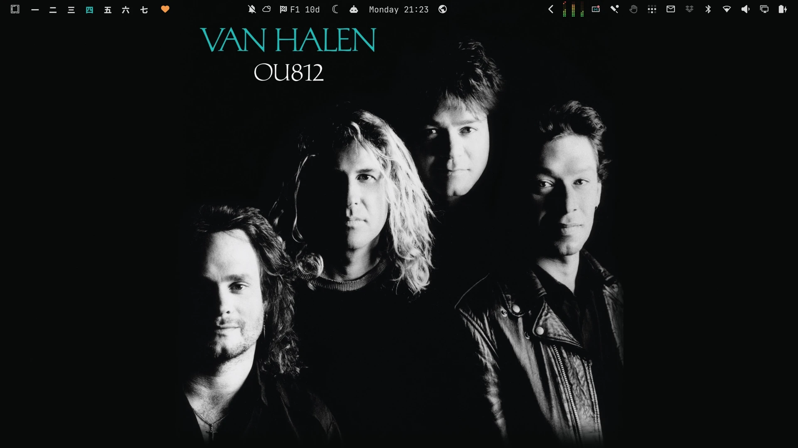
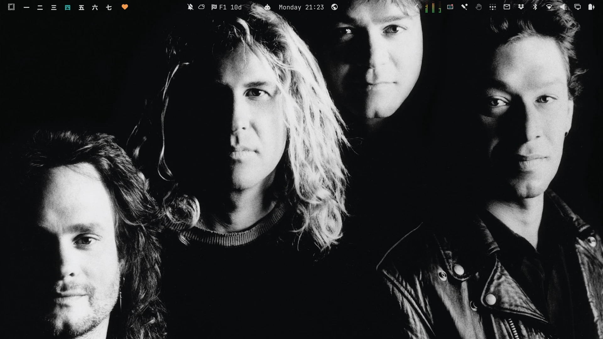
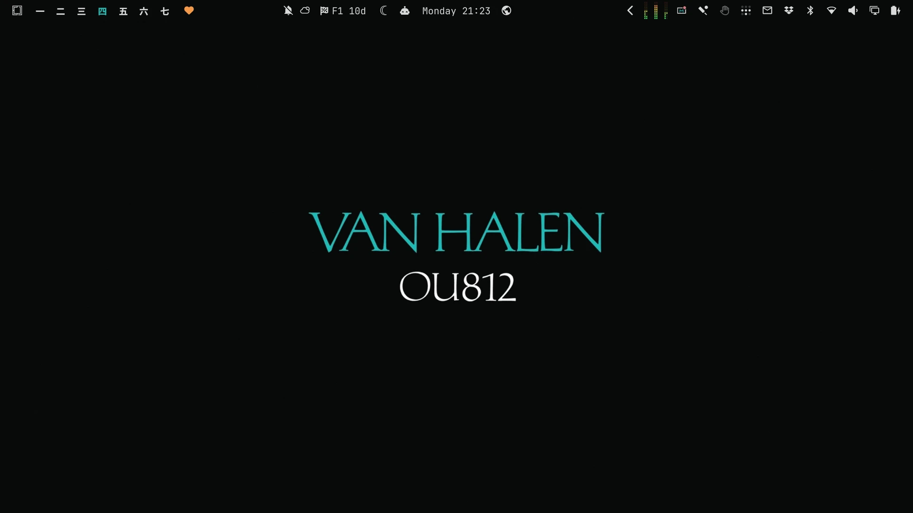
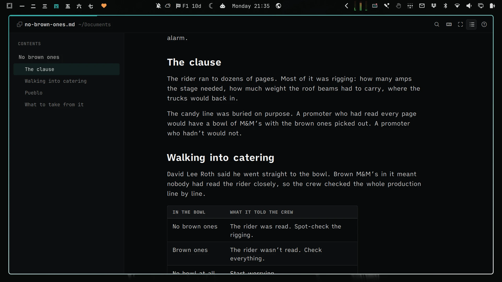
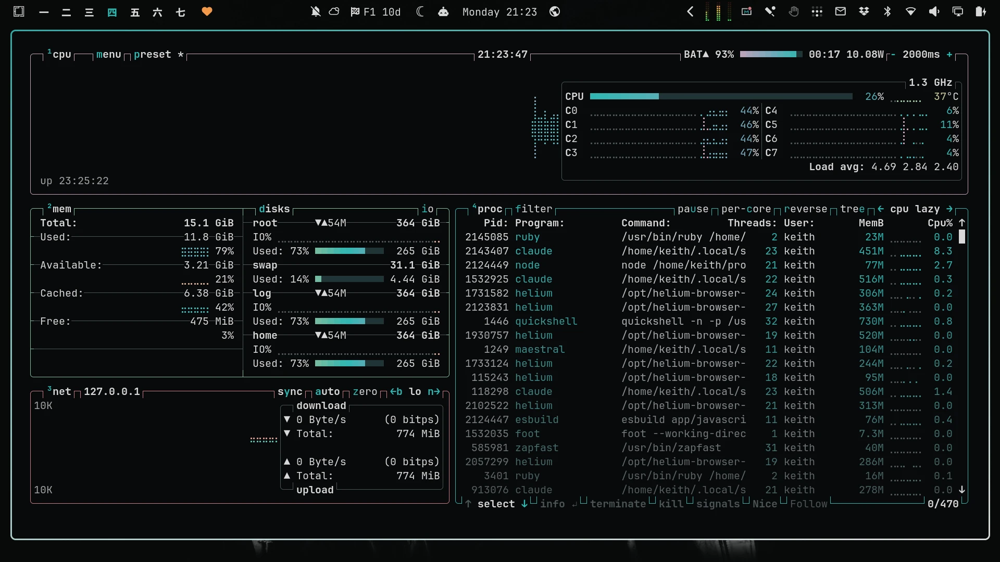

# OU812

An [Omarchy](https://omarchy.org/) theme from the cover of Van Halen's *OU812* (Warner Bros., 1988). The background is the black of the studio backdrop. Text is the silver of the portrait, and the accent is the teal of the VAN HALEN lettering.


## Install

```bash
omarchy theme install https://github.com/keithrowell/omarchy-ou812-theme
```

The theme applies as soon as it installs.

## Backgrounds

<p>



</p>

## OmarkyReader

[OmarkyReader](https://github.com/keithrowell/omarky) reads Markdown in the theme's colours.



## btop



## Licence

The theme files are MIT licensed, see [LICENSE](LICENSE). The wallpapers and screenshots are built from the album artwork, which belongs to its rights holders. This is an unofficial fan theme.
