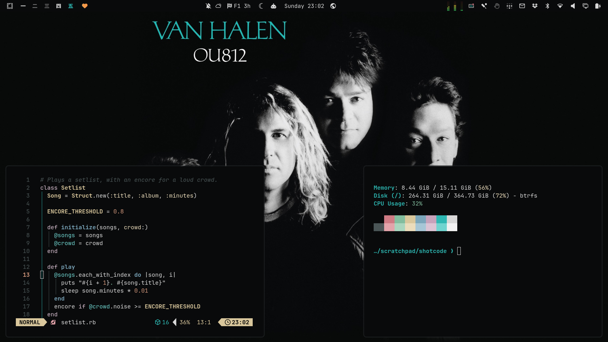

# OU812

An [Omarchy](https://omarchy.org/) theme taken from the cover of Van Halen's *OU812* (Warner Bros., 1988). The background is the black of the studio backdrop. Text is the silver of the black-and-white portrait, and the accent is the teal of the VAN HALEN lettering.



## Install

```bash
omarchy theme install https://github.com/keithrowell/omarchy-ou812-theme
```

Then pick **Ou812** from the theme switcher. Omarchy capitalises only the first letter of a theme's name, so the U stays lower case.

## Backgrounds

Each wallpaper is 2560x1600 on the cover's own black, with a light film grain.

| File | Shows |
|------|-------|
| `1-ou812.jpg` | The full cover, with its edges faded into the black |
| `2-the-band.jpg` | A wide crop of the four faces |
| `3-title.jpg` | The title lettering alone, for a quiet screen |

Cycle through them with `omarchy theme bg next`.

## Palette

The neutrals and the teal were sampled from the cover. The portrait is close to monochrome with a faint pink cast in the highlights, and the warm colours are built from that cast.

| Role | Colour | Source |
|------|--------|--------|
| Background | `#090a0b` | The backdrop |
| Foreground | `#d8d8d8` | The portrait's silver |
| Bright foreground | `#f2f2f2` | The OU812 lettering |
| Accent and cyan | `#2db7b2` | The VAN HALEN lettering |
| Dim foreground | `#6f7d81` | The portrait's slate shadows |
| Magenta | `#c7a2bb` | The pink cast in the highlights |

Window borders run from the teal to the white at 45 degrees, the two lines of the cover's type. The full set is in [`colors.toml`](colors.toml).

## Licence

The theme files are MIT licensed, see [LICENSE](LICENSE). The wallpapers and preview are built from the album artwork, which belongs to its rights holders. This is an unofficial fan theme.
